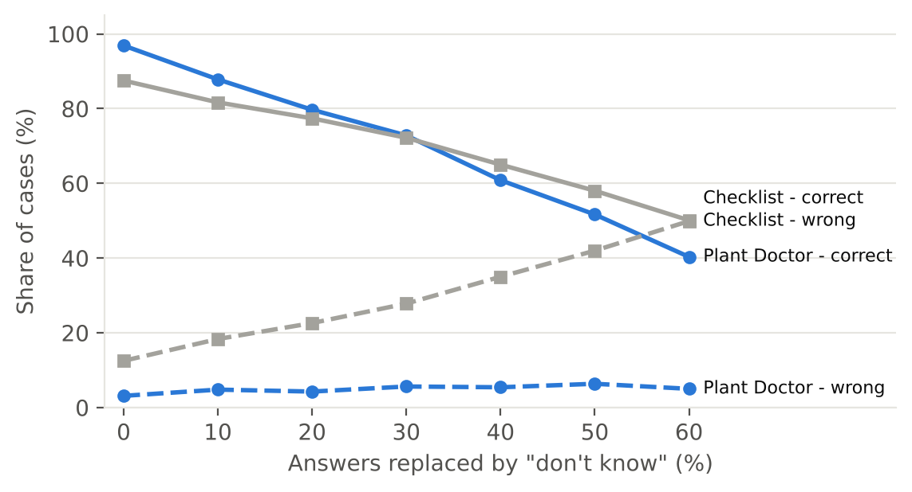

# Plant Doctor 🌿

A **rule-based expert system** that diagnoses common indoor plant problems. It works like an interview: it asks you questions about your plant, reasons over a knowledge base of 87 rules, and gives you a diagnosis, a confidence level, an explanation and recommended actions.

Built for **ICT206 Intelligent Systems** at Murdoch University.

## Highlights

- **Inference engine** written from scratch: forward chaining with **MYCIN-style certainty factors**
- **Goal-driven questioning**: it only asks questions that can still change the result (typically 16–25 of 29)
- **Explanations**: "Why are you asking this?" shows the rules a question tests, and "How did you decide?" shows the full rule trace
- **Handles uncertainty**: you can answer "don't know" and it reasons with what it has, or holds back a diagnosis instead of guessing
- **Knowledge base kept separate from the code**: 29 questions, 87 rules and 16 diagnoses in `knowledge_base.json`, so you can add knowledge without changing any code
- **Two interfaces**: a Tkinter GUI and a command-line consultation
- **No dependencies**: it runs on the Python standard library alone

## Results

Evaluated on 32 held-out test cases (typical, partial, noisy, multi-problem and healthy plants):

| Metric | Result |
|---|---|
| Primary diagnosis correct | **96.9%** (target ≥ 80%) |
| Correct, including acceptable co-diagnosis | 100% |
| Expected diagnosis in top 3 | 100% |
| Baseline: flat symptom checklist | 87.5% |
| Baseline: majority class | 12.5% |
| Order independence (1,600 random answer orders) | 0 differences |

As more answers are replaced with "don't know", Plant Doctor holds back instead of guessing, so its wrong-diagnosis rate stays around 5%. The checklist baseline's error rate climbs to 50%:



## Getting started

Requires Python 3.8 or later. Tkinter is included with the standard Python installer.

```bash
git clone https://github.com/efy124/plant-doctor.git
cd plant-doctor

python gui.py                 # graphical interface (recommended)
python plant_doctor.py        # command-line consultation
```

On Windows you can also double-click `run_gui.bat`, `run_plant_doctor.bat` or `run_evaluation.bat`.

### More commands

```bash
python plant_doctor.py --demo                               # replay an example consultation
python plant_doctor.py --answers examples/fern_brown_tips.json  # non-interactive run
python plant_doctor.py --check                              # validate the knowledge base
python evaluate.py --set test                               # evaluate on the held-out test set
python evaluate.py --set dev                                # evaluate on the development set
python evaluate.py --no-charts                              # evaluate without matplotlib
```

Charts need matplotlib: `pip install -r requirements.txt`. Random trials use fixed seeds, so the results repeat exactly.

### Command-line keys

During the interview, type the option number, or `u` don't know · `w` why are you asking? · `h` help · `b` back · `q` quit.
After the result: `h` how it was decided · `a` your answers · `s` save a report · `r` new plant · `q` quit.

## Project structure

```
engine.py              Inference engine: forward chaining, certainty factors,
                       goal-driven questioning, explanations
knowledge_base.json    29 questions, 87 rules, 16 diagnoses
gui.py                 Tkinter graphical interface
plant_doctor.py        Command-line interface
evaluate.py            Evaluation: accuracy, baselines, rule coverage,
                       order independence, robustness, efficiency
test_cases.json        10 development + 32 held-out test scenarios
examples/              Sample answer file for --answers
results/               Evaluation outputs (CSV, summaries, charts)
results/v1_before_refinement/   Results before the v2 knowledge-base refinement
```

## Author

Efthymios Sioras
